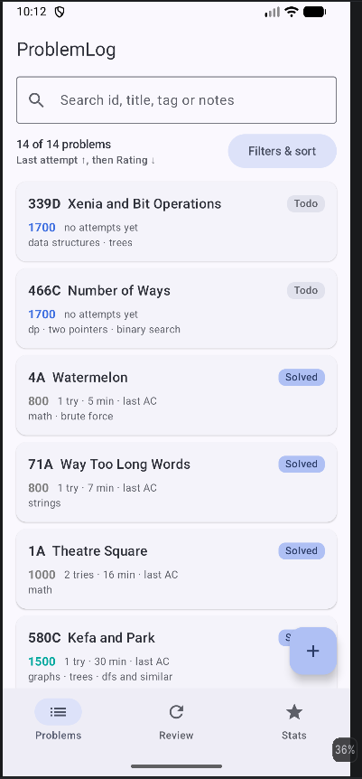
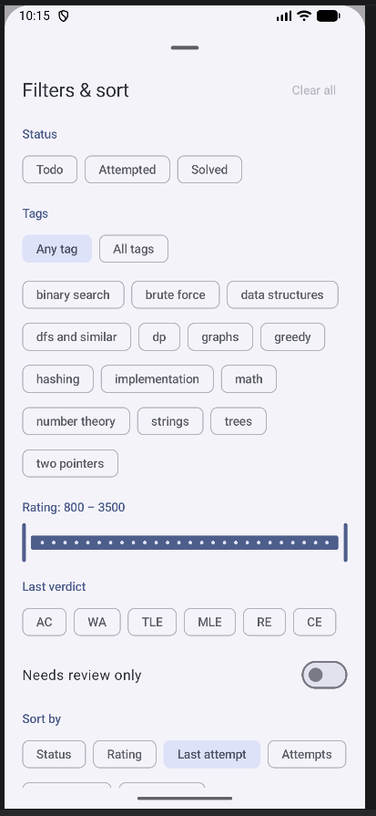
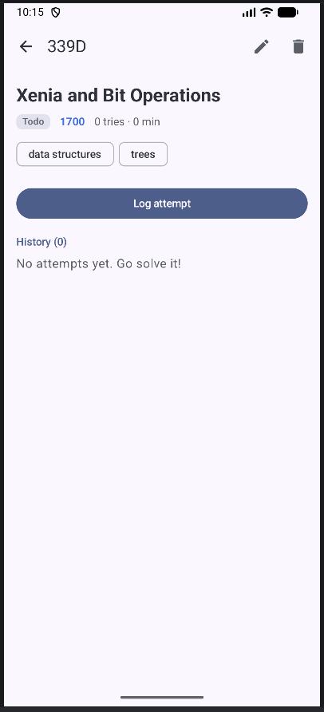
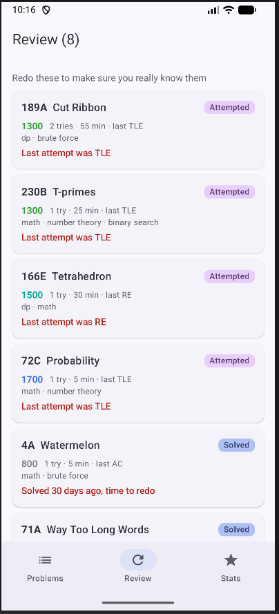
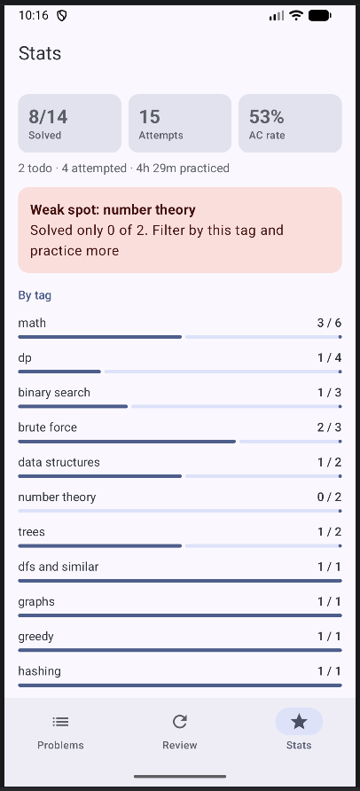

# ProblemLog (Android)

ProblemLog is a small Android app for tracking my Codeforces practice. When I train I solve some problems and fail others, and after a week I don't remember which ones were hard and why. So here I save every problem I tried, log each attempt with verdict and minutes, and then the app tells me what to redo and where my weak topics are.

It is the mobile version of my ProblemLog web project (Go + PostgreSQL), same idea but built with Kotlin and Jetpack Compose.

## Features

**1. Problem list with rich search, filter and multi sort**
- search box looks in problem id (`4A`), title, tags and notes, it waits 300 ms after typing so it doesnt refilter on every key
- filters: status (todo / attempted / solved), tags with **Any** or **All** mode, rating range slider (800 - 3500), last verdict (AC, WA, TLE...), and "needs review only"
- sorting by two keys: primary + secondary, each one asc or desc. keys are status, rating, last attempt, number of attempts, time spent, problem id
- example: "Status ↑, then Rating ↓" shows unsolved hard problems on top
- badge on the filter button shows how many filters are active

**2. Logging attempts with automatic status**
- on the detail screen you press "Log attempt", choose verdict and minutes
- AC marks the problem as **solved**
- a failed attempt on a **todo** problem moves it to **attempted**
- snackbar tells what changed, full attempts history is shown (newest first)
- add, edit and delete problems. while adding, known tags are suggested as chips so you don't make typos in tag names

**3. Review list (simple spaced repetition)**
- problems where the last attempt failed
- problems solved more than 14 days ago
- failed ones come first, then oldest solved

**4. Stats**
- solved count, total attempts, AC rate, time practiced
- solved/total per tag and per rating range (800-999, 1000-1199, ...) with progress bars
- "weak spot" card: tag with the lowest solved ratio (only tags with 2+ problems). with sample data it shows `dp`, solved 1 of 4

App starts with 13 real Codeforces problems as sample data, so every screen has something to show right away.

## Screens and navigation

Navigation Compose with 5 destinations:

| Route | Screen |
|---|---|
| `problems` | problem list + search + filter sheet (bottom tab) |
| `review` | review list (bottom tab) |
| `stats` | stats (bottom tab) |
| `problem/{id}` | problem detail, attempts history, log attempt dialog |
| `edit?id={id}` | add problem (no id) or edit problem (with id) |

Bottom bar is shown only on the 3 tab screens. Tabs use `saveState` / `restoreState` so the list scroll positon is kept when you switch tabs.

## Architecture

```
data/      Models.kt (Problem, Attempt, Status, Verdict)
           SampleData.kt, ProblemRepository.kt (in memory StateFlow)
logic/     ProblemRules.kt (status rule, review rule, form validation)
           FilterState.kt (filter + multi key sort)
           Stats.kt (per tag / per rating stats)
ui/        ProblemsViewModel.kt
           navigation/AppNavHost.kt
           screens/  list, detail, edit, review, stats
           components/  ProblemCard, FilterSheet, StatusBadge, SearchField ...
```

- **UI** only draws state and sends events. Every screen has a `...Route` composable which collects state from the ViewModel and a stateless `...Screen` composable which gets plain values + lambdas (state hoisting)
- **logic** is plain Kotlin functions, no Android stuff inside, so the rules are easy to read and test
- **data**: `ProblemRepository` is the single source of truth. now it keeps data in memory, later in semester it will be replaced with Room without changing the screens

### State management

- `ProblemsViewModel` holds the state as `StateFlow`: `visibleProblems`, `filter`, `query`, `stats`, `reviewItems`, `allTags`
- `visibleProblems` is built with `combine(problems, query.debounce(300), filter)` then filter + sort, it runs on `Dispatchers.Default`
- the sort is a chain of comparators: primary `.then(secondary)` `.thenBy { id }`
- screens collect with `collectAsStateWithLifecycle()`, so collection stops when the app is in background
- the search query is kept in `SavedStateHandle`
- changes (log attempt, save, delete) go through `viewModelScope.launch` into suspend functions of the repository

### Configuration changes

- rotating the screen keeps everyting: ViewModel survives rotation, so list, filters and sort stay
- pure UI state uses `rememberSaveable`: filter sheet open/closed, dialogs open, all form fields on add/edit screen, verdict and minutes in the log dialog
- `remember` is used for things that should not be saved, like `SnackbarHostState`, coroutine scope and the "now" timestamp on detail screen

## Tech

- Kotlin, Jetpack Compose, Material 3 (dynamic colors from template theme)
- Navigation Compose
- ViewModel + StateFlow + SavedStateHandle
- Kotlin coroutines and Flow (`combine`, `debounce`, `map`, `stateIn`, `withContext`)
- Kotlin features used: data classes, enums, sealed interfaces (`SaveResult`, `ReviewReason`), extension functions, collection ops (`groupBy`, `flatMap`, `fold`, `sortedWith`, `minByOrNull`)

## How to run

1. Clone the repo
   ```
   git clone <repo-url>
   ```
2. Open the folder in Android Studio (File → Open), wait for Gradle sync to finish
3. Select an emulator or a real phone (Android 7.0 / API 24 or newer)
4. Press **Run ▶** (Shift + F10)

## Screenshots

| Problem list | Filters & sort | Problem detail |
|---|---|---|
|  |  |  |

| Review | Stats |
|---|---|
|  |  |

## Plans for second half

- Room database instead of in memory list
- import problem title, rating and tags from Codeforces API by id
- daily reminder with WorkManager when review list is not empty
